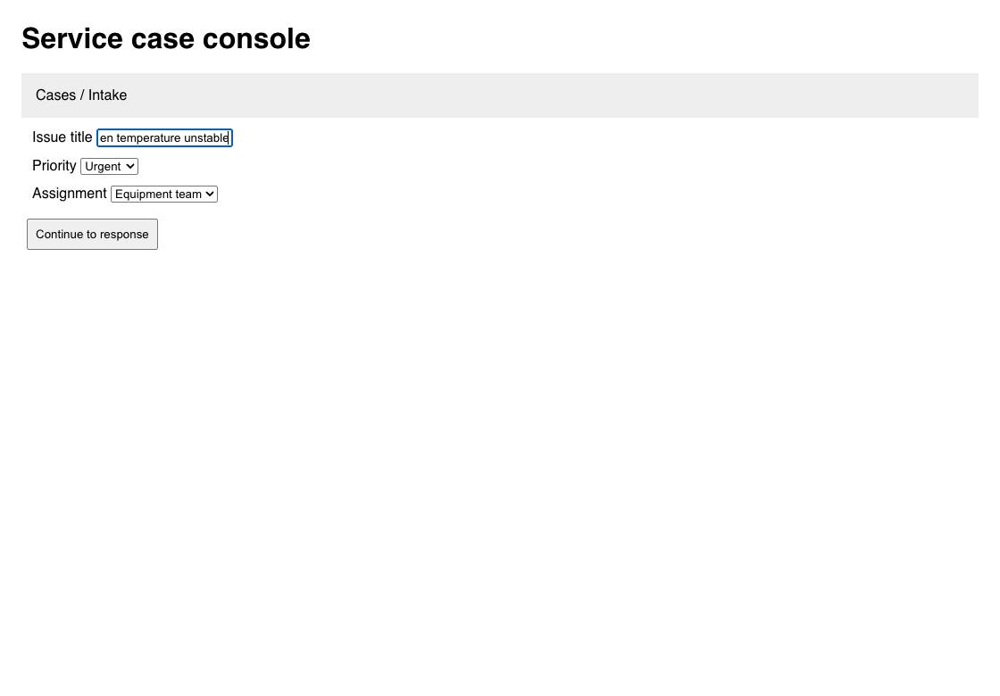

# Jev image routing around clipped fields

The final clipping-based candidate passed **139/142** graded browser attempts, with **3 false successes**. It completed the service-case workflow **3/3**, compared with **0/3** for the shared-image DOM control. No model weights were trained; this changes evidence placement in the TypeSafe request.

## Frozen paired outcomes

| Variant | 24-task confirmation | 8 compound development | 6 compound regression | 4 search regression | 8 additional transfer |
|---|---:|---:|---:|---:|---:|
| Visual Decisions | 66/72 | 14/16 | 18/18 | 12/12 | 19/24 |
| Shared-image DOM Jev | 71/72 | 16/16 | 15/18 | 12/12 | 21/24 |
| Clipping-based Jev | 72/72 | 16/16 | 18/18 | 12/12 | 21/24 |

The candidate source is `bd63ca508ea85908fa729bbe240480a4bf028241`, rebased onto `master` at `b9e5b08af6fdcf52170d9b55633db4463e9de357`. Both Jev profiles pin **jev-1.14.0**. Visual Decisions returned **gpt-6-luna**. Every final attempt is retained; expected safety stops must match their contract, and successful mutations must pass independent final-page and side-effect checks. These are fixture-supplied fill values with generative completion and fallback disabled.

The first four suites are reused confirmation/development/regression data. The additional eight-task transfer set was declared before its model evaluation and was not used for tuning. It consists of existing fixtures absent from the earlier retained paid datasets, not a secret benchmark. See [method](method.md) for the complete task list and protocol.

## What the image policy changes

A cropped or horizontally scrolled input can show a misleading substring while its DOM value is correct. Shared-image Jev repeatedly chose to replace the already complete issue title instead of advancing the form. Recorded-state ablation selected CLICK 3/3 without the image and TYPE_TEXT 3/3 with it. Wording changes and a complete-action Choice did not solve that conflict.



For a populated editable control whose scroll/overflow metrics show clipping, `dom_targets` places the same screenshot and candidate rectangles only in conditional target questions. The operation and irreversible-action judgments then use full DOM facts. Other pages keep shared visual evidence. All candidates, question meanings, confidence thresholds, freshness checks and execution gates are preserved; there is no extra decision round trip or fixture-specific rule.

The semantic DOM tree also now preserves styled checked states and controls nested in headings. Short labels remain whole until escaped secret echoes are scrubbed; oversized text is omitted in full while traversal continues. Offscreen DOM changes preserve the existing viewport-scoped freshness behavior. The final tool result includes a bounded tree, following the role/name/state shape inspected in Codex browser chats; details are in [the preceding DOM report](../hillclimb/README.md).

## Cost and latency

| Confirmation variant | Median wall ms | Median wire ms | Decisions | Input tokens | False success |
|---|---:|---:|---:|---:|---:|
| Visual Decisions | 1,905.5 | 219.5 | 246 | 509,203 | 3 |
| Shared-image DOM Jev | 1,515.5 | 133.0 | 211 | 1,277,318 | 1 |
| Clipping-based Jev | 1,577.5 | 131.0 | 215 | 1,307,630 | 0 |

**Neither Jev profile scoped any images in the basic confirmation suite.** All 215 candidate calls and 211 control calls used shared images. Their 72-vs-71 score and token/latency differences cannot be attributed to clipping-based routing; they include ordinary run variation and different action traces. The service-case regression is the direct test of the changed branch.

- confirmation: 0 scoped, 215 shared-image, 0 text-only wire calls; 215 image references.
- complex-dev: 2 scoped, 92 shared-image, 0 text-only wire calls; 98 image references.
- compound-regression: 9 scoped, 105 shared-image, 0 text-only wire calls; 141 image references.
- search-regression: 0 scoped, 27 shared-image, 0 text-only wire calls; 27 image references.
- transfer: 0 scoped, 42 shared-image, 21 text-only wire calls; 42 image references.

Repeated references increase input size on scoped calls. Whole-task tokens also increase when a formerly blocked run performs the remaining work, so do not treat cross-outcome totals as a fixed per-call overhead. The shared machine is not an isolated latency benchmark, provider tokenizers differ, and no dollar-cost or production accuracy claim is made. [Wire metadata](wire-metadata.json) records the actual placements and returned model IDs.

## Failures and limits

All three candidate false successes are `escape_popup`: its actual goal is
"Set the city to Paris, then press Go." Jev selects the Paris suggestion and
closes the dropdown, then chooses DONE before pressing Go. The Go button and its
conditional target answer are present; the first attempt assigns it target
confidence 0.99 but chooses DONE at operation confidence 0.66. This is premature
completion of a multi-step goal, not a missing value or transport failure. The
transfer results were not used to tune this frozen candidate.

- confirmation, Visual Decisions: `twin_by_context` 0/3.
- confirmation, Visual Decisions: `table_row_by_context` 2/3.
- confirmation, Visual Decisions: `icon_by_picture` 1/3.
- confirmation, Shared-image DOM Jev: `frame_form` 2/3.
- complex-dev, Visual Decisions: `complex_allocation` 0/2.
- compound-regression, Shared-image DOM Jev: `complex_holdout_5` 0/3.
- transfer, Visual Decisions: `icon_by_picture_twin` 2/3.
- transfer, Visual Decisions: `login_form` 1/3.
- transfer, Visual Decisions: `one_time_code_resolved` 1/3.
- transfer, Shared-image DOM Jev: `escape_popup` 0/3.
- transfer, Clipping-based Jev: `escape_popup` 0/3.

There were **zero recorded transport errors**. Two Visual Decisions attempts ended in error after repeated required `click_target` refusals on the one-time-code task; these remain in the totals. Full raw requests, responses, confidence distributions, model IDs and failed outcomes are retained. The paired summaries include outcome wins/losses and wall-time differences. Small repeated fixture sets do not establish a general real-world success rate. The default remains Workflow with images off; the evaluated profile is opt-in:

```sh
JEV_PROMPT_PROFILE=dom_targets JEV_IMAGES=1 JEV_MODEL=jev-1.14.0 roder
```

## Retained evidence and reproduction

- [Freeze manifest](freeze.json): 361 source/fixture hashes, isolated binary SHA-256, source commit, upstream base and predeclared suites; validate the committed sources with `python3 verify_source.py`.
- [Method and negative development results](method.md); [development manifest](development.json).
- 426 complete final browser attempts; 205 development/interrupted browser attempts; 109 recorded-state paid judgments. These sets are separate and are not pooled into one accuracy figure.
- [Paid reproduction commands](reproduce.sh), [exact-request replay helper](replay.py), [summary generator](summarize.py), [image-scope inspector](inspect.py).
- confirmation: [raw rows](confirmation.jsonl.gz), [summary](confirmation-summary.json), [paired](confirmation-paired.json).
- complex-dev: [raw rows](complex-dev.jsonl.gz), [summary](complex-dev-summary.json), [paired](complex-dev-paired.json).
- compound-regression: [raw rows](compound-regression.jsonl.gz), [summary](compound-regression-summary.json), [paired](compound-regression-paired.json).
- search-regression: [raw rows](search-regression.jsonl.gz), [summary](search-regression-summary.json), [paired](search-regression-paired.json).
- transfer: [raw rows](transfer.jsonl.gz), [summary](transfer-summary.json), [paired](transfer-paired.json).

## Local validation

Rust **1.95.0**: `cargo test -p roder-ext-jev -- --test-threads=4` passed **722 library tests**, with 13 paid/live tests ignored, and all integration/doc tests passed. `make fmt`, `make fmt-check`, crate all-target Clippy with `-D warnings`, changeset validation and knope configuration checks passed. Real Chrome regressions cover field clipping, long-text traversal, encoded secret echoes, heading controls, styled toggles and offscreen freshness.

The replay and inspection helpers also pass checks for optimized-Python failures,
corrupt source hashes, duplicate source basenames, exclusive output creation, and
readable plain/gzip replay output. These helper checks make no paid calls.
